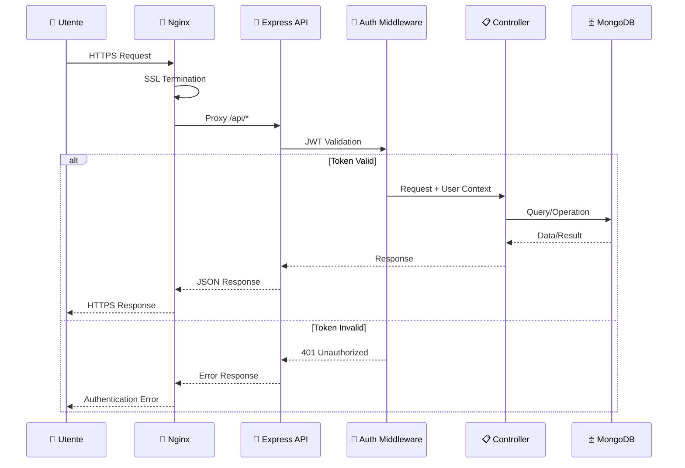
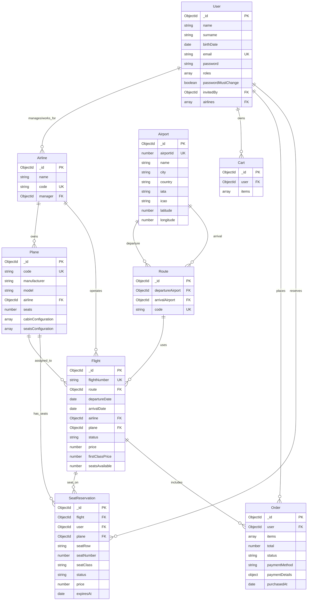
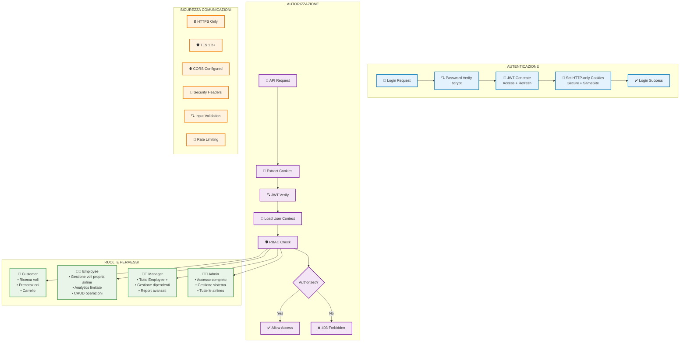
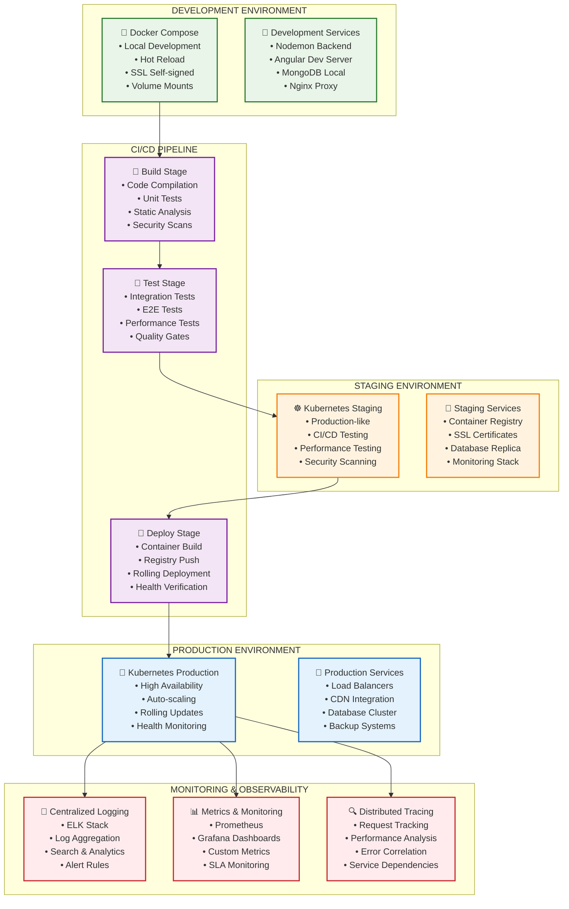
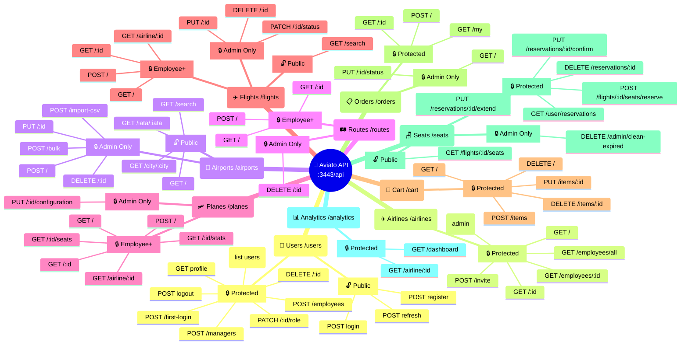

# Diagramma della Struttura - Progetto Aviato

## 1. Architettura Generale del Sistema

```mermaid
graph TB
    subgraph "LAYER UTENTE"
        U1[👤 Clienti<br/>• Ricerca Voli<br/>• Prenotazioni<br/>• Carrello<br/>• Selezione Posti]
        U2[👨‍💼 Dipendenti<br/>• Gestione Voli<br/>• Analytics<br/>• Gestione Flotta<br/>• Rotte/Aeroporti]
        U3[👨‍💻 Amministratori<br/>• Gestione Utenti<br/>• Gestione Sistema<br/>• Supervisione<br/>• Configurazioni]
    end

    subgraph "LAYER FRONTEND"
        F1[🌐 Site Angular<br/>:4543 HTTPS<br/>• Home/Ricerca<br/>• Login/Signup<br/>• Carrello<br/>• Selezione Posti<br/>• Profilo Utente]
        F2[📊 Dashboard Angular<br/>:4443 HTTPS<br/>• Analytics Dashboard<br/>• Gestione Voli<br/>• Gestione Utenti<br/>• Gestione Rotte<br/>• Gestione Aerei]
    end

    subgraph "LAYER PROXY"
        P1[🔧 Nginx Site<br/>• SSL Termination<br/>• Static Assets<br/>• /api/* → Backend<br/>• HTTP → HTTPS<br/>• Gzip Compression]
        P2[🔧 Nginx Dashboard<br/>• SSL Termination<br/>• Static Assets<br/>• /api/* → Backend<br/>• HTTP → HTTPS<br/>• Gzip Compression]
    end

    subgraph "LAYER API"
        API[🚀 Backend Express<br/>Node.js 20 + Express 5<br/>:3443 HTTPS]
        
        subgraph "Controllers"
            C1[Users]
            C2[Airlines]
            C3[Airports]
            C4[Routes]
            C5[Planes]
            C6[Flights]
            C7[Cart]
            C8[Orders]
            C9[Seats]
            C10[Analytics]
        end
        
        subgraph "Middleware"
            M1[🔐 Auth JWT]
            M2[🌐 CORS]
            M3[👮 RBAC]
            M4[⚠️ Error Handler]
            M5[📝 Logging]
            M6[🔍 Validation]
        end
    end

    subgraph "LAYER DATABASE"
        DB[(🗄️ MongoDB :27017)]
        
        subgraph "Collections"
            COL1[users<br/>• roles[]<br/>• airlines[]<br/>• passwordMustChange]
            COL2[airlines<br/>• name, code<br/>• manager]
            COL3[airports<br/>• OpenFlights<br/>• IATA/ICAO<br/>• coordinates]
            COL4[routes<br/>• departure<br/>• arrival]
            COL5[planes<br/>• cabinConfig<br/>• seatsConfig]
            COL6[flights<br/>• route, plane<br/>• prices<br/>• seatsAvailable]
            COL7[carts<br/>• user<br/>• items[]]
            COL8[orders<br/>• user, items[]<br/>• payment]
            COL9[seatreservations<br/>• flight, user<br/>• row, number<br/>• expiresAt TTL]
        end
    end

    subgraph "LAYER ORCHESTRAZIONE"
        DOCKER[🐳 Docker Compose<br/>• backend<br/>• mongo<br/>• dashboard<br/>• site]
        CERTS[🔐 Certificates<br/>• localhost.pem<br/>• localhost-key.pem<br/>• Self-signed SSL]
        VOLUMES[💾 Volumes<br/>• mongo-data<br/>• shared certs<br/>• persistent DB]
    end

    U1 --> F1
    U2 --> F2
    U3 --> F2
    F1 --> P1
    F2 --> P2
    P1 --> API
    P2 --> API
    API --> DB
    DB --> COL1
    DB --> COL2
    DB --> COL3
    DB --> COL4
    DB --> COL5
    DB --> COL6
    DB --> COL7
    DB --> COL8
    DB --> COL9
    DOCKER --> API
    DOCKER --> DB
    DOCKER --> P1
    DOCKER --> P2
    CERTS --> P1
    CERTS --> P2
    CERTS --> API
    VOLUMES --> DB

    classDef userLayer fill:#e1f5fe,stroke:#01579b,stroke-width:2px
    classDef frontendLayer fill:#f3e5f5,stroke:#4a148c,stroke-width:2px
    classDef proxyLayer fill:#e8f5e8,stroke:#1b5e20,stroke-width:2px
    classDef apiLayer fill:#fff3e0,stroke:#e65100,stroke-width:2px
    classDef dbLayer fill:#fce4ec,stroke:#880e4f,stroke-width:2px
    classDef orchestLayer fill:#f1f8e9,stroke:#33691e,stroke-width:2px

    class U1,U2,U3 userLayer
    class F1,F2 frontendLayer
    class P1,P2 proxyLayer
    class API,C1,C2,C3,C4,C5,C6,C7,C8,C9,C10,M1,M2,M3,M4,M5,M6 apiLayer
    class DB,COL1,COL2,COL3,COL4,COL5,COL6,COL7,COL8,COL9 dbLayer
    class DOCKER,CERTS,VOLUMES orchestLayer
```

## 2. Flusso delle Richieste HTTP



## 3. Modello dei Dati e Relazioni



## 4. Architettura di Sicurezza



## 5. Flusso di Prenotazione Completo

```mermaid
flowchart TD
    Start([🚀 Inizio Prenotazione]) --> Search[🔍 Ricerca Voli]
    
    Search --> Results{Risultati trovati?}
    Results -->|No| NoResults[❌ Nessun volo disponibile]
    Results -->|Si| SelectFlight[✈️ Selezione Volo]
    
    SelectFlight --> AuthCheck{Utente autenticato?}
    AuthCheck -->|No| Login[🔑 Login/Signup]
    AuthCheck -->|Si| AddToCart[🛒 Aggiungi al Carrello]
    Login --> AddToCart
    
    AddToCart --> CartView[👀 Visualizza Carrello]
    CartView --> SeatSelection{Selezione posti?}
    
    SeatSelection -->|Si| SeatMap[🪑 Mappa Posti]
    SeatSelection -->|No| Checkout[💳 Checkout]
    
    SeatMap --> SeatAvailable{Posto disponibile?}
    SeatAvailable -->|No| SeatMap
    SeatAvailable -->|Si| SeatHold[⏰ Hold Temporaneo 15min]
    
    SeatHold --> SeatConfirm[✅ Conferma Posto]
    SeatConfirm --> Checkout
    
    Checkout --> ValidateCart[🔍 Validazione Carrello]
    ValidateCart --> AvailabilityCheck{Posti ancora disponibili?}
    
    AvailabilityCheck -->|No| UpdateCart[🔄 Aggiorna Carrello]
    AvailabilityCheck -->|Si| Payment[💰 Processo Pagamento]
    UpdateCart --> CartView
    
    Payment --> PaymentSuccess{Pagamento riuscito?}
    PaymentSuccess -->|No| PaymentError[❌ Errore Pagamento]
    PaymentSuccess -->|Si| CreateOrder[📋 Creazione Ordine]
    
    CreateOrder --> ConfirmSeats[🪑 Conferma Prenotazioni Posti]
    ConfirmSeats --> UpdateInventory[📊 Aggiorna Inventario]
    UpdateInventory --> SendConfirmation[📧 Invio Conferma]
    SendConfirmation --> OrderComplete[✅ Ordine Completato]
    
    PaymentError --> Checkout
    NoResults --> Search

    classDef processStep fill:#e1f5fe,stroke:#01579b,stroke-width:2px
    classDef decisionStep fill:#fff3e0,stroke:#e65100,stroke-width:2px
    classDef errorStep fill:#ffebee,stroke:#c62828,stroke-width:2px
    classDef successStep fill:#e8f5e8,stroke:#2e7d32,stroke-width:2px

    class Start,Search,SelectFlight,Login,AddToCart,CartView,SeatMap,SeatHold,SeatConfirm,Checkout,ValidateCart,Payment,CreateOrder,ConfirmSeats,UpdateInventory,SendConfirmation,UpdateCart processStep
    class Results,AuthCheck,SeatSelection,SeatAvailable,AvailabilityCheck,PaymentSuccess decisionStep
    class NoResults,PaymentError errorStep
    class OrderComplete successStep
```



## 6. Architettura dei Container Docker

```mermaid
graph TB
    subgraph "DOCKER COMPOSE ORCHESTRATION"
        DC[🐳 docker-compose.yml]
    end

    subgraph "NGINX CONTAINERS"
        N1[📦 nginx-site<br/>Port: 4543:443<br/>• Serve Static Assets<br/>• SSL Termination<br/>• API Proxy]
        N2[📦 nginx-dashboard<br/>Port: 4443:443<br/>• Serve Static Assets<br/>• SSL Termination<br/>• API Proxy]
    end

    subgraph "APPLICATION CONTAINERS"
        APP[📦 backend<br/>Port: 3443:3443<br/>• Node.js 20<br/>• Express 5<br/>• HTTPS Native]
    end

    subgraph "DATABASE CONTAINERS"
        MONGO[📦 mongo<br/>Port: 27017:27017<br/>• MongoDB 6+<br/>• Persistent Volume<br/>• Internal Network]
    end

    subgraph "SHARED VOLUMES"
        V1[💾 mongo-data<br/>• Database Persistence<br/>• Backup Ready]
        V2[🔐 ./certs<br/>• SSL Certificates<br/>• Shared Across Containers]
    end

    subgraph "NETWORKS"
        NET[🌐 default (bridge)<br/>• Internal Communication<br/>• Service Discovery<br/>• Isolated Environment]
    end

    subgraph "ENVIRONMENT VARIABLES"
        ENV1[🔧 Backend ENV<br/>• MONGO_URI<br/>• JWT_SECRET<br/>• SSL_PORT]
        ENV2[🔧 Frontend ENV<br/>• API_URL<br/>• PRODUCTION<br/>• SSL_CONFIG]
    end

    DC --> N1
    DC --> N2
    DC --> APP
    DC --> MONGO
    
    V1 --> MONGO
    V2 --> N1
    V2 --> N2
    V2 --> APP
    
    NET --> N1
    NET --> N2
    NET --> APP
    NET --> MONGO
    
    ENV1 --> APP
    ENV2 --> N1
    ENV2 --> N2

    N1 -.->|proxy /api/*| APP
    N2 -.->|proxy /api/*| APP
    APP -.->|mongoose| MONGO

    classDef containerStyle fill:#e3f2fd,stroke:#1565c0,stroke-width:2px
    classDef volumeStyle fill:#e8f5e8,stroke:#2e7d32,stroke-width:2px
    classDef networkStyle fill:#fff3e0,stroke:#ef6c00,stroke-width:2px
    classDef envStyle fill:#f3e5f5,stroke:#7b1fa2,stroke-width:2px

    class N1,N2,APP,MONGO containerStyle
    class V1,V2 volumeStyle
    class NET networkStyle
    class ENV1,ENV2 envStyle
```

## 7. Performance e Monitoring Architecture

```mermaid
graph TB
    subgraph "PERFORMANCE MONITORING"
        subgraph "DATABASE PERFORMANCE"
            DB_PERF[📊 MongoDB Metrics<br/>• Query Performance<br/>• Index Usage<br/>• Connection Pool<br/>• Slow Query Log]
            DB_INDEX[🔍 Index Strategy<br/>• Compound Indexes<br/>• TTL Indexes<br/>• Query Optimization<br/>• Explain Plans]
        end
        
        subgraph "API PERFORMANCE"
            API_PERF[⚡ API Metrics<br/>• Response Times<br/>• Throughput (RPS)<br/>• Error Rates<br/>• Endpoint Analytics]
            API_CACHE[💾 Caching Strategy<br/>• Nginx Gzip<br/>• Browser Cache<br/>• Static Assets<br/>• API Response Cache]
        end
        
        subgraph "FRONTEND PERFORMANCE"
            FE_PERF[🎯 Frontend Metrics<br/>• Core Web Vitals<br/>• Bundle Size<br/>• Loading Times<br/>• User Experience]
            FE_OPT[🚀 Optimizations<br/>• Lazy Loading<br/>• Tree Shaking<br/>• Code Splitting<br/>• Image Optimization]
        end
    end

    subgraph "MONITORING STACK"
        HEALTH[💓 Health Checks<br/>• /health endpoint<br/>• Service Status<br/>• Dependency Checks<br/>• Automated Alerts]
        
        LOGS[📝 Logging<br/>• Structured JSON<br/>• Request/Response<br/>• Error Tracking<br/>• Audit Trail]
        
        METRICS[📈 Metrics Collection<br/>• Response Times<br/>• Resource Usage<br/>• Business KPIs<br/>• Custom Metrics]
        
        ALERTS[🚨 Alerting<br/>• Threshold Alerts<br/>• Anomaly Detection<br/>• Error Rate Spikes<br/>• Performance Degradation]
    end

    subgraph "SCALABILITY"
        HORIZONTAL[↔️ Horizontal Scaling<br/>• Stateless Design<br/>• Load Balancing<br/>• Container Replication<br/>• Auto-scaling]
        
        VERTICAL[↕️ Vertical Scaling<br/>• Resource Limits<br/>• CPU/Memory Scaling<br/>• Database Tuning<br/>• Connection Pooling]
        
        CACHING[🔄 Caching Layers<br/>• Redis (Future)<br/>• CDN Integration<br/>• Browser Caching<br/>• Application Cache]
    end

    DB_PERF --> METRICS
    API_PERF --> METRICS
    FE_PERF --> METRICS
    HEALTH --> ALERTS
    LOGS --> ALERTS
    METRICS --> ALERTS
    
    HORIZONTAL --> HEALTH
    VERTICAL --> METRICS
    CACHING --> API_PERF

    classDef perfStyle fill:#e8f5e8,stroke:#388e3c,stroke-width:2px
    classDef monitorStyle fill:#e3f2fd,stroke:#1976d2,stroke-width:2px
    classDef scaleStyle fill:#fff3e0,stroke:#f57c00,stroke-width:2px

    class DB_PERF,DB_INDEX,API_PERF,API_CACHE,FE_PERF,FE_OPT perfStyle
    class HEALTH,LOGS,METRICS,ALERTS monitorStyle
    class HORIZONTAL,VERTICAL,CACHING scaleStyle
```

## 8. Deployment Strategy



## 9. Security Implementation Details

```mermaid
graph TB
    subgraph "AUTHENTICATION LAYER"
        AUTH_JWT[🎫 JWT Implementation<br/>• Access Token (1h)<br/>• Refresh Token (7d)<br/>• HS256 Algorithm<br/>• Secret from ENV]
        
        AUTH_COOKIE[🍪 Cookie Security<br/>• HTTP-only Flag<br/>• Secure Flag<br/>• SameSite=Strict<br/>• Automatic Expiry]
        
        AUTH_BCRYPT[🔐 Password Security<br/>• bcrypt Hashing<br/>• Salt Rounds: 10<br/>• Timing Attack Protection<br/>• Password Policy]
    end

    subgraph "AUTHORIZATION LAYER"
        AUTHZ_RBAC[🛡️ Role-Based Access Control<br/>• 4 Roles Hierarchy<br/>• Granular Permissions<br/>• Middleware Chain<br/>• Resource Scoping]
        
        AUTHZ_SCOPE[🎯 Airline Scoping<br/>• Employee Limitations<br/>• Manager Boundaries<br/>• Admin Full Access<br/>• Data Isolation]
        
        AUTHZ_GUARD[🚪 Route Guards<br/>• Express Middleware<br/>• Angular Guards<br/>• Role Validation<br/>• Permission Checks]
    end

    subgraph "COMMUNICATION SECURITY"
        COMM_HTTPS[🔒 HTTPS Enforcement<br/>• TLS 1.2+ Only<br/>• SSL Certificates<br/>• HTTP Redirect<br/>• HSTS Headers]
        
        COMM_CORS[🌐 CORS Configuration<br/>• Origin Whitelist<br/>• Credentials Support<br/>• Preflight Handling<br/>• Security Headers]
        
        COMM_HEADERS[📋 Security Headers<br/>• X-Frame-Options<br/>• X-Content-Type-Options<br/>• X-XSS-Protection<br/>• Content-Security-Policy]
    end

    subgraph "INPUT VALIDATION"
        VALID_SCHEMA[✅ Schema Validation<br/>• Mongoose Schemas<br/>• Type Checking<br/>• Required Fields<br/>• Custom Validators]
        
        VALID_SANITIZE[🧹 Input Sanitization<br/>• XSS Prevention<br/>• SQL Injection Protection<br/>• NoSQL Injection Protection<br/>• HTML Escaping]
        
        VALID_RATE[⏱️ Rate Limiting<br/>• Request Throttling<br/>• IP-based Limits<br/>• Endpoint-specific<br/>• DDoS Protection]
    end

    subgraph "DATA PROTECTION"
        DATA_ENCRYPT[🔐 Data Encryption<br/>• Password Hashing<br/>• Sensitive Data Masking<br/>• Database Encryption<br/>• Backup Encryption]
        
        DATA_AUDIT[📋 Audit Logging<br/>• User Actions<br/>• Admin Operations<br/>• Data Changes<br/>• Access Logs]
        
        DATA_BACKUP[💾 Secure Backups<br/>• Encrypted Storage<br/>• Access Controls<br/>• Retention Policies<br/>• Recovery Testing]
    end

    AUTH_JWT --> AUTHZ_RBAC
    AUTH_COOKIE --> AUTHZ_GUARD
    AUTH_BCRYPT --> DATA_ENCRYPT
    
    AUTHZ_RBAC --> VALID_SCHEMA
    AUTHZ_SCOPE --> VALID_SANITIZE
    AUTHZ_GUARD --> VALID_RATE
    
    COMM_HTTPS --> DATA_ENCRYPT
    COMM_CORS --> DATA_AUDIT
    COMM_HEADERS --> DATA_BACKUP

    classDef authStyle fill:#e3f2fd,stroke:#1565c0,stroke-width:2px
    classDef authzStyle fill:#f3e5f5,stroke:#7b1fa2,stroke-width:2px
    classDef commStyle fill:#e8f5e8,stroke:#2e7d32,stroke-width:2px
    classDef validStyle fill:#fff3e0,stroke:#ef6c00,stroke-width:2px
    classDef dataStyle fill:#ffebee,stroke:#c62828,stroke-width:2px

    class AUTH_JWT,AUTH_COOKIE,AUTH_BCRYPT authStyle
    class AUTHZ_RBAC,AUTHZ_SCOPE,AUTHZ_GUARD authzStyle
    class COMM_HTTPS,COMM_CORS,COMM_HEADERS commStyle
    class VALID_SCHEMA,VALID_SANITIZE,VALID_RATE validStyle
    class DATA_ENCRYPT,DATA_AUDIT,DATA_BACKUP dataStyle
```

## 10. API Endpoints Overview



---

## Come utilizzare questi diagrammi

### 🎯 **Per sviluppatori**
- I diagrammi Mermaid possono essere visualizzati direttamente in GitHub, GitLab, e molti editor
- Utilizzare gli IDE con plugin Mermaid per preview in tempo reale
- I diagrammi sono modificabili e versionabili insieme al codice

### 🔧 **Per documentazione**
- Integrare nei README.md del progetto
- Utilizzare in presentazioni e design documents
- Esportare come immagini PNG/SVG per documentazione statica

### 📊 **Per analisi**
- I diagrammi di flusso aiutano nell'identificazione di bottleneck
- L'architettura dei container guida il deployment
- I modelli di sicurezza supportano audit e compliance

### 🚀 **Per deployment**
- I diagrammi Docker guidano la configurazione dell'ambiente
- L'architettura di monitoring definisce la strategia operativa
- I flussi API supportano testing e integrazione

Questi diagrammi rappresentano fedelmente l'architettura del progetto Aviato e possono essere utilizzati come riferimento tecnico per sviluppo, deployment e manutenzione del sistema.