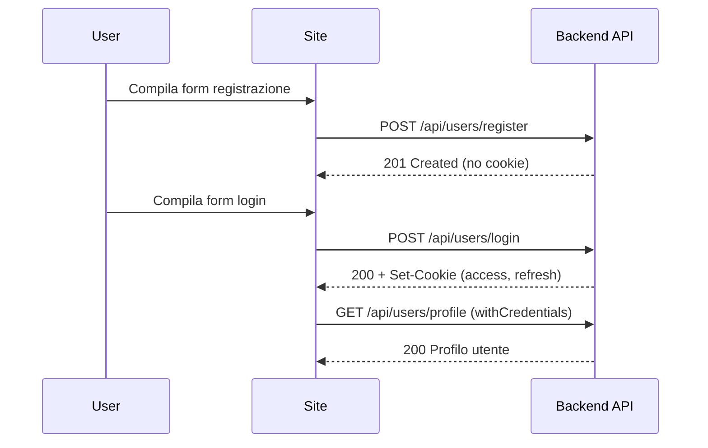
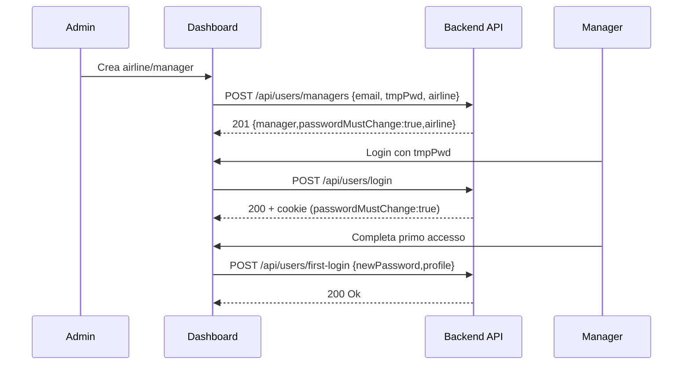
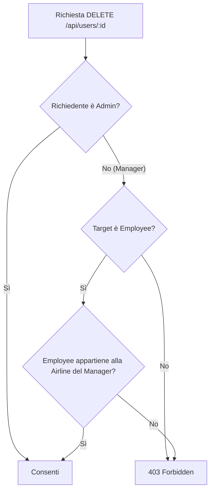
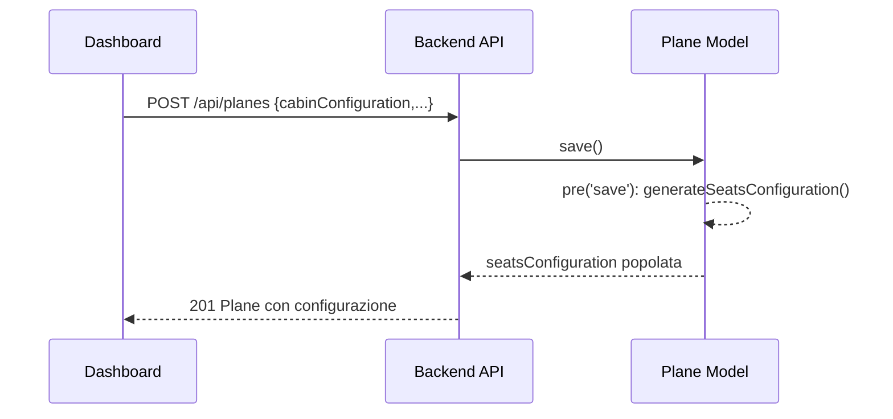
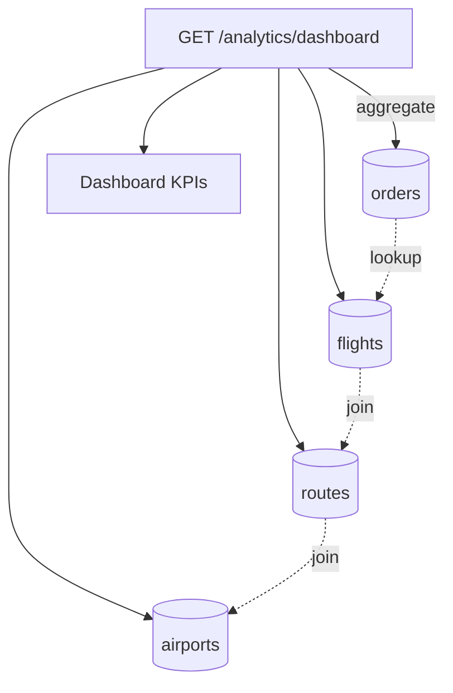
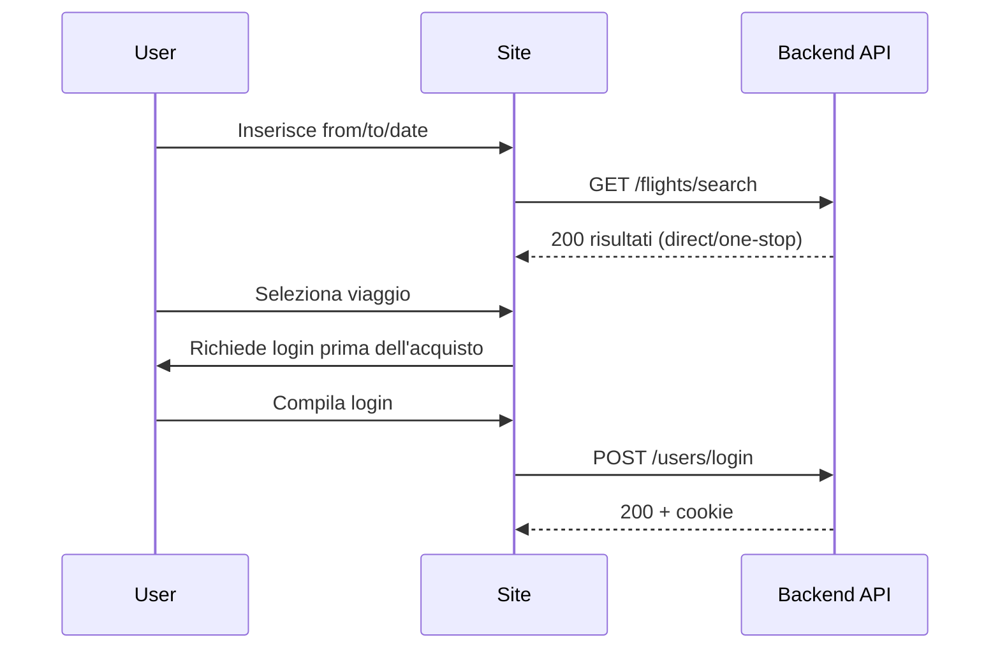
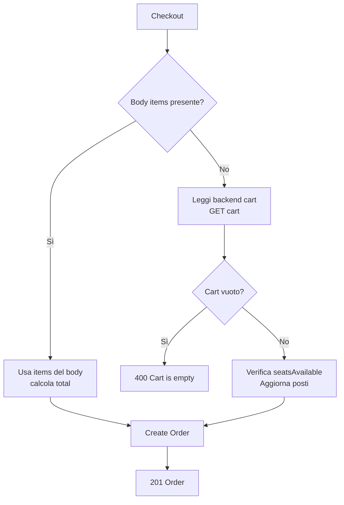
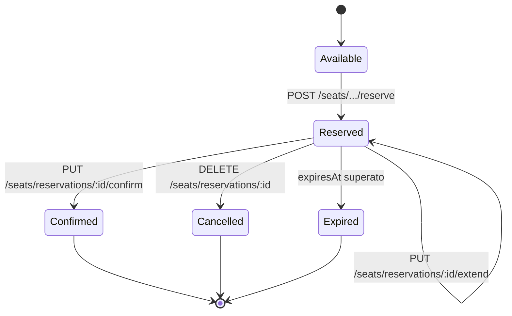

# Relazione di progetto — Aviato

## Introduzione
Aviato è una piattaforma end‑to‑end per la gestione delle prenotazioni voli. Comprende:
- un backend HTTPS RESTful basato su Node.js/Express con MongoDB,
- due SPA Angular: il front‑office “Site” per i clienti e il back‑office “Dashboard” per il personale (admin/manager/employee),
- un’infrastruttura di esecuzione containerizzata con Nginx per la pubblicazione delle SPA e reverse‑proxy verso le API.

L’obiettivo è supportare i requisiti funzionali di autenticazione, ricerca voli, carrello, selezione posti, checkout ordini e analytics operative per le compagnie.

## Architettura del sistema
L’architettura è modulare e container‑first.

- Backend API (`backend/`): Express 5 su Node 20, HTTPS nativo con certificati self‑signed in sviluppo. Persistenza su MongoDB tramite Mongoose 8. Autenticazione con JWT su cookie HTTP‑only. Middleware `protect` e ACL per ruoli.
- Database: MongoDB. Collezioni per utenti, compagnie, aeroporti, rotte, aerei, voli, carrelli, ordini, prenotazioni posti.
- Front‑office (`site/`): Angular 19 (standalone), Tailwind v4. Consuma le API con `withCredentials`.
- Back‑office (`dashboard/`): Angular 19, `AuthGuard` con controllo ruoli, viste CRUD e analytics.
- Pubblicazione SPA: Nginx nei container dei frontend serve asset statici e fa reverse‑proxy `/api/*` → backend (TLS pass‑through; in dev `proxy_ssl_verify off`).
- Orchestrazione (`docker-compose.yml`): servizi `backend` (3443/tcp), `mongo` (27017/tcp), `dashboard` (4443/tcp), `site` (4543/tcp). I certificati in `./certs` sono montati nel backend e nei container Nginx.

Flusso di chiamata in sviluppo:
```
Browser utente → HTTPS (4443/4543) → Nginx SPA → proxy /api → HTTPS (3443) → Express → MongoDB
```

Diagramma architettura (Mermaid):
```mermaid
flowchart LR
  subgraph Browser
    U1[Utente Cliente]
    U2[Utente Staff]
  end
  subgraph Frontend
    S[Site (Angular)]
    D[Dashboard (Angular)]
  end
  subgraph Nginx
    N1[Nginx Site]
    N2[Nginx Dashboard]
  end
  subgraph Backend
    B[Express API (HTTPS)]
  end
  M[(MongoDB)]

  U1 -->|HTTPS 4543| S --> N1
  U2 -->|HTTPS 4443| D --> N2
  N1 -->|/api proxy (HTTPS)| B
  N2 -->|/api proxy (HTTPS)| B
  B <--> M
```

## Modello dei dati (MongoDB)
Il dominio è modellato con schemi Mongoose. Di seguito le collezioni principali e un estratto dei documenti.

- Utenti (`users`): profili e ruoli
  - Campi: `name`, `surname`, `birthDate`, `email (unique)`, `password (bcrypt)`, `roles: ["customer"|"employee"|"manager"|"admin"]`, `passwordMustChange`, `invitedBy (User)`, `airlines: [Airline]`.
```json
{
  "_id": "67a1...",
  "email": "alice@example.com",
  "roles": ["customer"],
  "airlines": []
}
```

- Compagnie (`airlines`): anagrafiche compagnie
  - Campi: `name`, `code (unique, uppercase)`, `manager (User)`. Virtual `employees` (join su `users.airlines` con ruolo `employee`).
```json
{ "_id": "67a2...", "name": "Aviato Air", "code": "AV", "manager": "67a1..." }
```

- Aeroporti (`airports`): dataset stile OpenFlights
  - Campi: `airportId (unique number)`, `name`, `city`, `country`, `iata`, `icao`, geo, `timezone`, `dst`, `tzDatabaseTimezone`, `type`, `source`.
```json
{ "_id": "67a3...", "airportId": 1555, "name": "Malpensa", "iata": "MXP", "city": "Milan" }
```

- Rotte (`routes`): tratta A→B
  - Campi: `departureAirport (Airport)`, `arrivalAirport (Airport)`, `code (unique)`.
```json
{ "_id": "67a4...", "departureAirport": "67a3...", "arrivalAirport": "67a5...", "code": "MXP-FCO" }
```

- Aerei (`planes`): configurazione cabina e mappa posti
  - Campi: `code (unique)`, `manifacturer`, `model`, `airline (Airline)`, `seats`, `totalRows`, `maxSeatsPerRow`, `cabinConfiguration: [{ name, seatClass, startRow, endRow, seatsPerRow, seatLayout, priceMultiplier }]`, `seatsConfiguration: [ {row, number, seatClass, isAisle, isWindow, ...} ]`.
```json
{
  "_id": "67a6...",
  "code": "AV320",
  "airline": "67a2...",
  "cabinConfiguration": [{ "name": "Economy", "seatClass": "economy", "startRow": "1", "endRow": "25", "seatsPerRow": 6, "seatLayout": "3-3" }]
}
```

- Voli (`flights`): pianificazione voli
  - Campi: `flightNumber (unique)`, `route (Route)`, `departureDate`, `arrivalDate`, `airline (Airline)`, `plane (Plane)`, `status`, `price`, `firstClassPrice`, `additionalLuggagePrice`, `seatsAvailable`. Indice `{ route: 1, departureDate: 1 }`.
```json
{ "_id": "67a7...", "flightNumber": "AV123", "route": "67a4...", "price": 89, "status": "scheduled" }
```

- Carrelli (`carts`): carrelli per utente
  - Campi: `user (User)`, `items: [{ flight (Flight), quantity, priceAtAdd }]`. Virtual `totalPrice`.
```json
{ "_id": "67a8...", "user": "67a1...", "items": [{ "flight": "67a7...", "quantity": 2, "priceAtAdd": 89 }] }
```

- Ordini (`orders`): checkout e pagamento
  - Campi: `user (User)`, `items: [{ flight, quantity, priceAtPurchase, additionalLuggage, seatClass, passengers }]`, `total`, `status`, `paymentMethod`, `paymentDetails`, `purchasedAt`.
```json
{ "_id": "67a9...", "user": "67a1...", "total": 208, "status": "Completed", "paymentMethod": "Credit Card" }
```

- Prenotazioni posto (`seatreservations`): hold e conferma
  - Campi: `flight (Flight)`, `user (User)`, `plane (Plane)`, `seatRow`, `seatNumber`, `seatClass`, `status: reserved|confirmed|cancelled`, `price`, `expiresAt`. Indici: unico composto `(flight, seatRow, seatNumber)`, `user+flight`, `expiresAt`.
```json
{ "_id": "67b0...", "flight": "67a7...", "seatRow": "C", "seatNumber": 4, "status": "reserved", "expiresAt": "2025-08-15T10:25:00.000Z" }
```

## API REST
Le API sono accessibili su `https://localhost:3443/api`. Le operazioni autenticate richiedono cookie HTTP‑only; i frontend impostano `withCredentials: true`.

- Utenti (`/users`)
  - POST `/register` (pubblico): crea utente
```json
{ "name": "Alice", "surname": "Rossi", "birthDate": "1992-04-05", "email": "alice@example.com", "password": "secretPW123" }
```
  - POST `/login` (pubblico): autentica e imposta cookie
  - POST `/refresh` (pubblico): rinnova token
  - POST `/logout` (protetto): invalida cookie
  - GET `/profile` (protetto): profilo corrente
  - GET `/` (protetto): lista utenti (admin tutti; manager solo dipendenti della propria airline). Query: `role`, `airline`
  - DELETE `/:id` (protetto admin/manager), PATCH `/:id/role` (admin/manager), PATCH `/:id/airline-role` (admin)
  - POST `/managers` (admin): crea manager + airline
  - POST `/employees` (admin/manager): crea employee per airline del manager
  - POST `/first-login` (protetto): cambio password al primo accesso

- Compagnie (`/airlines`)
  - POST `/` (admin), POST `/invite` (protetto), GET `/`, GET `/employees/all` (admin), GET `/employees/:airlineId` (protetto), GET `/:id`

- Aeroporti (`/airports`)
  - POST `/` (admin), POST `/bulk` (admin), POST `/import-csv` (admin, multipart `file`)
  - GET `/` (lista), GET `/search?q=...`
  - GET `/iata/:iata`, `/icao/:icao`, `/country/:country`, `/city/:city`, GET `/:id`
  - PUT `/:id` (admin), DELETE `/:id` (admin)

- Rotte (`/routes`)
  - POST `/` (employee/admin), GET `/`, GET `/:id`, DELETE `/:id` (admin)

- Aerei (`/planes`)
  - POST `/` (employee/admin), GET `/`, GET `/:id`, GET `/code/:code`, GET `/airline/:airlineId`
  - GET `/:id/seats` (mappa posti), GET `/:id/stats`
  - PUT `/:id/configuration` (admin)

- Voli (`/flights`)
  - POST `/` (employee/admin), GET `/`, GET `/search?from=...&to=...&departureDate=...`
  - GET `/:id`, PUT `/:id` (admin), DELETE `/:id` (admin)
  - GET `/airline/:airlineId` (protetto), PATCH `/:id/status` (admin)

- Carrello (`/cart`, protetto)
  - GET `/` (recupera/crea), POST `/items` (aggiunge volo)
```json
{ "flightId": "67a7...", "quantity": 1 }
```
  - PUT `/items/:itemId`, DELETE `/items/:itemId`, DELETE `/` (svuota)

- Ordini (`/orders`, protetto)
  - POST `/` (da body o carrello backend)
```json
{
  "items": [{ "flight": "67a7...", "quantity": 2, "priceAtPurchase": 89, "seatClass": "economy", "additionalLuggage": 1 }],
  "total": 208,
  "paymentMethod": "Credit Card",
  "paymentDetails": { "nonce": "tok_123" }
}
```
  - GET `/my`, GET `/:id`, GET `/` (admin), PUT `/ :id/status` (admin)

- Posti (`/seats`)
  - GET `/flights/:flightId/seats` (mappa e prezzi)
  - POST `/flights/:flightId/seats/reserve` (protetto)
```json
{ "plane": "67a6...", "seatRow": "C", "seatNumber": 4, "seatClass": "economy", "price": 15 }
```
  - PUT `/reservations/:reservationId/confirm` (protetto)
  - DELETE `/reservations/:reservationId` (protetto)
  - PUT `/reservations/:reservationId/extend` (protetto)
  - GET `/user/reservations` (protetto)
  - DELETE `/admin/clean-expired` (admin)

- Analytics (`/analytics`)
  - GET `/dashboard` (protetto): KPI globali per dipendenti
  - GET `/airline/:airlineId` (protetto): KPI per airline specifica

## Autenticazione e autorizzazione
L’autenticazione è gestita tramite cookie HTTP‑only:
- Login: `POST /users/login` imposta `accessToken` (scadenza ~1h) e `refreshToken` (~7d).
- Refresh: `POST /users/refresh` ruota entrambi i token leggendo i cookie.
- Accesso: middleware `protect` valida l’`accessToken` e popola `req.user`.
- CORS: origini consentite includono `http://localhost:4200`, `https://localhost:4443`, `https://localhost:4543`; `credentials: true`.
- Ruoli e permessi: `customer`, `employee`, `manager`, `admin`. ACL applicata a livello di route; in Dashboard un `AuthGuard` legge il profilo (via `/users/profile`) e verifica i ruoli richiesti nella `data` della route.
- Primo accesso manager: flusso `passwordMustChange` risolto da `POST /users/first-login`.

Nota di configurazione (dev): finché non allineati, impostare `JWT_REFRESH_SECRET == JWT_SECRET` come indicato in `backend/README.md`.

## Front‑end Angular

- Site (clienti)
  - Rotte: `/` (Home), `/login`, `/signup`, `/user`, `/cart`, `/seat-selection/:flightId`, `/order-confirmation/:orderId`.
  - Servizi:
    - `AuthService`: stato utente con Angular Signals; bootstrap su `/api/users/profile`.
    - `CartService`: stato del carrello locale e sincronizzazione con `/api/cart` e `/api/cart/items`.
    - `OrderService`: creazione ordine, `GET /orders/my`, `GET /orders/:id`.
    - `BaseApiService`, `SeatReservationService`, `NotificationService`.
  - Networking: `environment.apiUrl = 'https://localhost:3443/api'`, proxy dev (`proxy.conf.json`) per `/api`, richieste con `withCredentials: true`.
  - UI: Tailwind v4; componenti pagine in `site/src/app/pages/*` (Home, Cart, Seat Selection, Login/Signup, User, Order Confirmation).

- Dashboard (personale)
  - Rotte protette da `AuthGuard`:
    - `/` (Dashboard analytics), `/user`
    - `/flights`, `/flights/create`
    - `/routes`, `/routes/create`
    - `/users`, `/users/create`, `/users/create-employee`, `/users/create-manager`
    - `/airlines`
    - `/planes`, `/planes/:id/seats`
    - `/login`, `/signup`, `/first-login`
  - Servizi:
    - `AuthService`: BehaviorSubject per utente, login/register/logout, refresh profilo.
    - `PlaneService`: CRUD aerei, mappa/stats posti, operazioni di prenotazione posti via `/seats/*`.
    - `AnalyticsService`: `/analytics/dashboard`, `/analytics/airline/:id`.
    - `BaseApiService`: wrapper GET/POST/PUT/PATCH/DELETE con `withCredentials`.

## Workflow applicativo per ruoli

- Cliente
  - Ricerca voli: dalla Home invia query a `GET /flights/search` (diretti/uno scalo).
  - Carrello: aggiunge un volo via `POST /cart/items` e visualizza `GET /cart`.
  - Selezione posti: ottiene mappa con `GET /seats/flights/:flightId/seats`, fa hold con `POST /seats/.../reserve`, opzionalmente conferma.
  - Checkout: crea ordine con `POST /orders` (totale calcolato; bagagli extra e posto opzionali). Visualizza ordini con `GET /orders/my`.

- Employee/Manager
  - Gestione rete e flotta: crea rotte (`POST /routes`), aerei (`POST /planes` con `cabinConfiguration`), voli (`POST /flights`), consulta mappa/stats posti per aereo e per volo.
  - Analytics operativa: dashboard con trend passeggeri/ricavi, rotte popolari e KPI per airline (`/analytics/airline/:id`).

- Admin
  - Governance: CRUD utenti e ruoli (`/users`), inviti e associazioni ad airline; gestione aeroporti (bulk/CSV), revisione ordini (`/orders`), pulizia prenotazioni scadute (`/seats/admin/clean-expired`).

## Implementazione dettagliata delle funzionalità e flow d'uso

### 1) User management

Questa area copre la registrazione, l’invito e il ciclo di vita degli utenti e delle airline. L’accesso alle funzioni “airline” richiede login.

- Registrazione di nuovi utenti (clienti)
  - Implementazione backend: `registerUser` crea un documento `User` con hashing bcrypt (hook `pre('save')`). Per design, la registrazione pubblica è riservata ai clienti; ruoli diversi vengono impostati dagli admin.
  - Nota cookie: la registrazione non imposta cookie. Le sessioni vengono instaurate al login (`loginUser`) che rilascia `accessToken` e `refreshToken` come cookie HTTP‑only.
  - Flow (esempio):
    1) Site → `POST /api/users/register` con `{ name, surname, birthDate, email, password }` → `201`.
    2) Site → `POST /api/users/login` con `{ email, password }` → cookie impostati + profilo.
    3) Site → `GET /api/users/profile` (bootstrap stato utente).

Diagramma — Registrazione e Login (clienti):


- Registrazione airline “by invitation” (solo admin)
  - Implementazione backend: `POST /api/users/managers` (`createManagerWithAirline`). Crea un utente con ruolo `manager`, password temporanea, flag `passwordMustChange: true`, quindi crea l’`Airline` e associa il manager.
  - Primo login: il manager accede con la password temporanea e completa il profilo via `POST /api/users/first-login` (cambio password, eventuale aggiornamento `name/surname/birthDate`), che azzera `passwordMustChange`.
  - Vincolo: le airline non possono auto‑registrarsi; la creazione è mediata da admin (o, per gli employee, da manager via `POST /api/users/employees`).
  - Flow (esempio):
    1) Admin (Dashboard) → `POST /api/users/managers` con `{ email, temporaryPassword, airlineName, airlineCode }` → `201` (ritorna `manager` e `airline`).
    2) Manager → `POST /api/users/login` (cookie) → `passwordMustChange: true`.
    3) Manager → `POST /api/users/first-login` con `{ currentPassword?, newPassword, name, surname, birthDate }` → `200`.
    4) Manager ora può usare le funzioni airline protette.

Diagramma — Invito Airline (admin) e First Login (manager):


- Cancellazione utenti (admin o manager con vincoli)
  - Implementazione backend: `DELETE /api/users/:id` controlla i ruoli. Il manager può cancellare solo dipendenti della propria airline (check incrociato su `user.airlines`). L’admin può cancellare qualsiasi utente.
  - Flow (esempio):
    1) Admin/Manager (Dashboard) → `DELETE /api/users/USER_ID` → `200`.

Diagramma — Cancellazione utente (vincoli manager):


- Nota amministratore iniziale
  - Come da specifica, l’account admin viene creato programmaticamente alla prima esecuzione del backend. Il pattern consigliato: all’avvio (dopo `connectDB()`), eseguire una funzione `ensureAdmin()` che cerca un admin; se assente, crea un utente con credenziali lette da variabili d’ambiente (es. `ADMIN_EMAIL`, `ADMIN_PASSWORD`).

### 2) Routes management (solo airline: manager/employee, con scope)

Gli utenti di airline gestiscono rete, flotta e voli; il controllo di scope impedisce operazioni su airline non proprie.

- Creazione di nuove rotte
  - Implementazione backend: `POST /api/routes` (`createRoute`) valida esistenza aeroporti e unicità `code`.
  - Flow: Dashboard → form rotta → `POST /api/routes` → `201` con rotta popolata.

Diagramma — Flusso creazione rotta → aereo → volo:
```mermaid
flowchart LR
  R[Create Route]\nPOST /routes --> P[Create Plane\nPOST /planes]
  P --> F[Create Flight\nPOST /flights]
  F --> S[Seat Map disponibile\nGET /seats/flights/:id/seats]
```

- Creazione di nuovi aerei
  - Implementazione backend: `POST /api/planes` (`createPlane`) con `cabinConfiguration`; hook `pre('save')` genera `seatsConfiguration` (layout per fila, flag corridoio/finestrino, bulkhead/emergency, statistiche via metodi del modello).
  - Flow: Dashboard → form aereo (code, modello, config cabina) → `POST /api/planes` → `201`.

Diagramma — Generazione mappa posti (pre-save):


- Creazione di voli
  - Implementazione backend: `POST /api/flights` (`createFlight`) verifica: unicità `flightNumber`, riferimenti validi (`route/airline/plane`), coerenza date, assenza sovrapposizioni per l’aereo, e imposta `seatsAvailable` dal `Plane`.
  - Flow: Dashboard → form volo (rotta, orari, aereo, prezzi) → `POST /api/flights` → `201` (entity popolata con route/airline/plane).

- Impostazione prezzi
  - Implementazione: prezzi per classe su `Flight` (`price`, `firstClassPrice`) e `additionalLuggagePrice`. Aggiornabili via `PUT /api/flights/:id`.
  - Nota: il prezzo del posto usa la classe (`seatClass`) nel calcolo lato backend Seat; eventuali sovrapprezzi specifici (es. extra legroom) possono essere modellati estendendo `Plane.cabinConfiguration` o la `SeatReservation` (vedi miglioramenti).

- Statistiche operative
  - Implementazione backend: `GET /api/analytics/dashboard` e `GET /api/analytics/airline/:airlineId` eseguono aggregazioni Mongo (join con `flights`, `routes`, `airports`) per passeggeri, revenue, rotte più richieste e revenue mensile.
  - Flow: Dashboard → pagina Analytics → chiamate ai due endpoint → rendering grafici.

Diagramma — KPI dashboard (aggregazioni):


### 3) Flight search (pubblica)

- Implementazione backend: `GET /api/flights/search` costruisce risultati diretti e con uno scalo. Filtra i voli passati, consente intervalli di date e sorting (`price|departureDate|duration|airline`).
- Flow (esempio, utente non autenticato):
  1) Site Home → query → `GET /api/flights/search?from=...&to=...&departureDate=...` → lista risultati (direct/one‑stop).
  2) Selezione viaggio → al checkout richiede login: `POST /api/users/login` → cookie.
  3) Prosegue con carrello/ordine (vedi sezione successiva).

Diagramma — Ricerca voli e login al checkout:


### 4) Tickets e seats

- Acquisto biglietti e extra
  - Implementazione: `OrderController.createOrder` accetta `items[]` dal frontend oppure legge il carrello backend; valida disponibilità (`seatsAvailable`), decrementa posti, calcola `total` e crea l’ordine. Gli extra includono `additionalLuggage` per item; il frontend può applicare un sovrapprezzo per selezione posto.
  - Flow (esempio):
    1) Site → `POST /api/cart/items` per aggiungere voli al carrello.
    2) Site → checkout → `POST /api/orders` con `{ items, total, paymentMethod, paymentDetails }` → `201` (status iniziale "Completed" in questa implementazione).

Diagramma — Creazione ordine (da frontend cart o backend cart):


- Selezione posti
  - Implementazione: mappa posti via `GET /api/seats/flights/:flightId/seats` (merge configurazione aereo + prenotazioni correnti). Hold temporaneo tramite `POST /api/seats/.../reserve` crea `SeatReservation` con scadenza (`expiresAt`, indice univoco per posto). Conferma/cancellazione/estensione via `PUT/DELETE` su `/api/seats/reservations/:id`.
  - Integrazione con l’ordine: è possibile confermare posti contestualmente all’ordine passando `seatReservations[]` a `POST /api/orders` (il controller crea prenotazioni "confirmed").
  - Flow (esempio):
    1) Site → `GET /api/seats/flights/<flightId>/seats` → mappa.
    2) Site → `POST /api/seats/flights/<flightId>/seats/reserve` → `201` (hold 15').
    3) Site → conferma nel checkout → `POST /api/orders` includendo i posti selezionati (oppure `PUT /api/seats/reservations/:id/confirm` pre‑ordine).

Diagramma — Selezione posto (hold → confirm/cancel/extend):


## Possibili miglioramenti e funzionalità aggiuntive

- Sicurezza e stabilità
  - Allineamento crittografico: unificare definitivamente le chiavi di firma/verifica per access/refresh token ed aggiungere rotazione con “reuse detection” del refresh token.
  - Hardening HTTP: `helmet`, HSTS su Nginx, cookie `SameSite` coerenti per ambienti cross‑site.
  - Rate limiting e protezioni: `express-rate-limit`, blocco IP per brute‑force su `/users/login`.
  - Validazione input: schema validation (Zod/Joi) su tutti gli endpoint, error handling uniforme.
  - Bugfix Mongoose: in `backend/models/Cart.js` il campo `flight` ha `red: "Flight"` invece di `ref: "Flight"`; correggerlo per garantire le popolazioni corrette e prevenire inconsistenze.
  - CSRF: valutare protezione CSRF per endpoint mutanti se in futuro si adottano sessioni non stateless.

- Esperienza utente
  - Pagamenti reali: integrazione con provider (Stripe/PayPal) e webhook per `status` ordini.
  - Prenotazioni posti in tempo reale: passare a lock distribuiti (Redis) per ridurre race conditions, con canali WebSocket/SSE per aggiornare la mappa posti live.
  - Accessibilità e i18n: WCAG AA, localizzazione (IT/EN), form con validazioni UX‑friendly.
  - Ricerca avanzata: filtri per classe tariffaria, bagagli, politiche di cambio; salvataggio ricerche e notifiche prezzo.

- Performance e scalabilità
  - Caching: Redis per cache dei risultati `flights/search` e lookup aeroporti; ETag/Cache‑Control su risorse statiche.
  - Indici DB: rivedere e aggiungere indici su campi di filtro frequenti (es. `flights.airline`, `orders.user`, `airports.iata/icao`).
  - Logging/monitoring: log strutturati (pino), metriche Prometheus/Grafana, tracing OpenTelemetry.
  - Background jobs: code (BullMQ) per processi di pulizia prenotazioni scadute, invio email, generazione report.

- Qualità e automazione
  - Documentazione API: generare OpenAPI/Swagger da annotazioni JSDoc esistenti e pubblicare `/docs`.
  - Test: unit/integration per controller e servizi Angular; E2E (Playwright/Cypress) per flussi critici; seed dati deterministic per test.
  - CI/CD: pipeline con lint, test, build immagini, scan vulnerabilità; ambienti di staging con certificati gestiti.

- Funzionalità aggiuntive
  - Programma fedeltà: punti/miglia legati agli ordini, status tier.
  - Gestione bagagli/servizi extra dettagliati con pricing dinamico.
  - Amministrazione avanzata: audit log, esportazioni CSV, ruoli granulari per airline.
  - Notifiche: email/SMS/push (ritardi, cambi gate, promemoria check‑in).

## Conclusioni
Aviato offre una base solida per la prenotazione voli con un’architettura chiara, un data model coerente e API REST ben segmentate. L’uso di cookie HTTP‑only con ACL per ruoli semplifica l’integrazione con le SPA Angular. Gli interventi proposti migliorano sicurezza, UX, osservabilità e scalabilità, preparando la piattaforma a un’evoluzione produttiva.
